# PerceptNet — Autonomous Perception Pipeline

PerceptNet is a 2D object detection pipeline for driving scenes, written in Python and C++.
The model is a fine-tuned ResNet backbone with a CenterNet-style anchor-free head, written in
**JAX/Flax** and trained with **Optax**. At inference time the forward pass and decoding are
compiled together into one **XLA** executable that can run on a GPU.

- **Preprocessing (OpenCV):** frames are letterboxed, converted BGR→RGB and normalized. Training
  and deployment run the same code. There is also a fused C++ version of this step.
- **Model (JAX/Flax):** ResNet-18/34 → stride-4 upsampling neck → three heads (class heatmap,
  box size, sub-pixel offset). Inputs are NHWC, compute can be `float32` or `bfloat16`.
- **Fine-tuning:** ImageNet ResNet weights are converted from safetensors with no PyTorch needed.
  For the first N steps the backbone is frozen (`optax.multi_transform`), then it trains at a
  reduced learning rate. Backbone BatchNorm can optionally stay frozen too.
- **XLA-compiled inference:** `jit(forward + decode).lower(...).compile()` runs once, ahead of
  time, for a fixed `(B, H, W, 3)` shape. The hot path does no retracing and runs no Python per
  layer. You can dump the StableHLO and the optimized HLO, and read XLA's cost analysis.
- **C++ kernels:** IoU, greedy and class-aware NMS, and OpenCV letterbox+normalize, exposed
  through pybind11. If the extension isn't built, everything falls back to NumPy.
- **Benchmarks:** compare NumPy, JAX (jit) and C++ on IoU, NMS, preprocessing, heatmap decode and
  matmul. They also compare end-to-end eager, `jit` and AOT latency across batch sizes.
- **Evaluation:** COCO-style mAP@[.5:.95], AP50/AP75, per-class AP, and a
  precision/recall/F1 sweep across score thresholds that picks the best operating point.

## Architecture

```mermaid
flowchart LR
    subgraph Input
        A[Camera frame / video / image<br/>BGR uint8] --> B
    end

    subgraph Preprocess["Preprocess (OpenCV / C++)"]
        B[Letterbox resize + pad] --> C[BGR→RGB, normalize<br/>NHWC float32]
    end

    subgraph XLA["Single AOT-compiled XLA executable (JAX)"]
        C --> D[ResNet-18/34 backbone<br/>C2..C5]
        D --> E[Upsampling neck<br/>stride 4]
        E --> F1[Heatmap head]
        E --> F2[Size head]
        E --> F3[Offset head]
        F1 & F2 & F3 --> G[Decode: sigmoid, 3x3 max-pool peaks,<br/>top-K, box assembly]
    end

    subgraph Post["Host post-processing"]
        G --> H[Score threshold]
        H --> I[Class-aware NMS<br/>C++ / NumPy]
        I --> J[Map back to original frame]
    end

    J --> K[Detections / visualization]
    J --> L[Evaluator: mAP, P/R/F1 sweep]

    subgraph Train["Training (jax.jit + Optax)"]
        M[COCO / synthetic dataset] --> N[Augment + CenterNet target encoding]
        N --> O[Focal + L1 losses]
        O --> P[AdamW, warmup-cosine,<br/>backbone freeze / LR mult]
        P --> Q[(msgpack checkpoints)]
    end
    Q -. weights .-> D
```



### Repository layout

```
perceptnet/
  config.py              dataclass config + YAML + --set overrides
  data/                  OpenCV preprocessing, COCO reader, synthetic dataset, augmentation, loader
  model/                 Flax backbone, neck, heads, detector, targets, losses, decode
  ops/                   IoU/NMS (NumPy + JAX), C++ dispatch layer (cpp_ext.py)
  train/                 train state, optimizer, checkpoints, pretrained loading, trainer
  inference/             AOT-compiled InferenceEngine, visualization
  eval/                  metrics (mAP, threshold sweep) and evaluation runner
  bench/                 numeric-op and end-to-end latency benchmarks
  cli.py                 `perceptnet` command
cpp/                     C++ kernels, pybind11 bindings, standalone benchmark (CMake)
scripts/                 ResNet safetensors -> Flax .npz converter
configs/                 synthetic smoke config, KITTI-in-COCO fine-tuning config
tests/                   pytest suite
```

## Installation

Requires Python 3.10+.

```bash
python -m venv .venv && source .venv/bin/activate
pip install -e ".[dev]"            # CPU JAX
# or, on an NVIDIA GPU machine:
pip install -e ".[dev,gpu]"        # jax[cuda12]
```

### Optional: build the C++ kernels

You need CMake ≥ 3.18, a C++17 compiler, pybind11 and (for the preprocessing kernel) OpenCV
development headers.

```bash
pip install pybind11
cmake -S cpp -B build -DCMAKE_BUILD_TYPE=Release
cmake --build build -j
# -> perceptnet/ops/_perceptnet_cpp*.so (picked up automatically) and build/bench_ops
./build/bench_ops 100               # standalone C++ micro-benchmarks
```

Without OpenCV headers the build still produces the NMS/IoU kernels and prints a warning.
`inference.backend` (`auto` | `cpp` | `numpy`) chooses which implementation is used.

## How to run

### 1. Quick start on synthetic data (CPU, a few minutes)

```bash
perceptnet train -c configs/synthetic.yaml
perceptnet eval  -c runs/synthetic/config.yaml --checkpoint runs/synthetic/best_model.msgpack
```

Training writes `config.yaml`, `last.msgpack` (full train state), `best_model.msgpack`
(best by mAP), `final_model.msgpack`, `history.json` and `last_eval.json` to
`train.output_dir`. Any config value can be overridden from the command line:

```bash
perceptnet train -c configs/synthetic.yaml --set train.epochs=3 --set data.batch_size=8
```

### 2. Fine-tune on real driving data (KITTI / BDD100K in COCO format)

```bash
pip install safetensors huggingface_hub
python scripts/convert_torchvision_resnet.py --arch resnet34 --out weights/resnet34_imagenet.npz
# put images + COCO annotation JSON under data/kitti/ (paths in configs/kitti_coco.yaml)
perceptnet train -c configs/kitti_coco.yaml
```

### 3. Inference

```bash
# image or folder of images -> annotated images + detections.json
perceptnet infer -c runs/synthetic/config.yaml --checkpoint runs/synthetic/best_model.msgpack \
    --source path/to/images --out outputs/infer

# video file or webcam (index 0) -> outputs/infer/output.mp4 and FPS / latency stats
perceptnet infer -c runs/synthetic/config.yaml --checkpoint runs/synthetic/best_model.msgpack --source drive.mp4
```

`--show` opens a live window. This needs the GUI build of OpenCV
(`pip install opencv-python` instead of the headless wheel).

From Python:

```python
import cv2
from perceptnet import load_config
from perceptnet.inference.engine import InferenceEngine

cfg = load_config("runs/synthetic/config.yaml")
engine = InferenceEngine.from_checkpoint(cfg, "runs/synthetic/best_model.msgpack")
engine.warmup()
dets = engine.detect([cv2.imread("frame.png")])[0]   # boxes in original pixels, scores, labels
```

### 4. Inspect the compiled XLA program

```bash
perceptnet export-hlo -c runs/synthetic/config.yaml --checkpoint runs/synthetic/best_model.msgpack --out outputs/hlo
# writes perceptnet.stablehlo.mlir and perceptnet.optimized.hlo.txt, prints compile time + FLOPs
```

### 5. Benchmarks

```bash
perceptnet bench --suite ops                         # NumPy vs JAX vs C++ numeric ops
perceptnet bench --suite latency -c configs/synthetic.yaml --batch-sizes 1,4,8
perceptnet bench --quick                             # everything, fewer iterations
```

The results are printed as a table and written to `outputs/bench.json` along with the JAX
backend and device list.

### 6. Evaluation output

`perceptnet eval` prints, and saves as JSON:

- mAP@[.5:.95], mAP50, mAP75, and AP at each IoU threshold
- per-class AP / AP50 with ground-truth and prediction counts
- precision / recall / F1 at score thresholds 0.05 … 0.95 (IoU 0.5), and the threshold with
  the best F1, which is the recommended `inference.score_threshold`

## How to test

```bash
pip install -e ".[dev]"
pytest                    # fast unit tests (CPU; JAX_PLATFORMS=cpu is set in conftest.py)
pytest -m slow            # end-to-end smoke test: 1 epoch of training + evaluation
pytest --cov=perceptnet   # with coverage
```

What the tests cover:

- **Preprocessing:** letterbox shapes and padding, box round-trip between frame and network
  coordinates, RGB ordering.
- **Ops:** IoU against known values, NumPy vs JAX parity for IoU and NMS, class-aware NMS. When
  the extension is built, also C++ vs NumPy parity for NMS, IoU and preprocessing.
- **Targets and decode:** gaussian heatmaps, size/offset targets, and an exact
  encode → decode round-trip.
- **Model:** output shapes, heatmap prior, input validation, backbone freezing in the optimizer.
- **Data:** synthetic determinism, COCO export/import, class filtering, fixed-shape batches with
  padding, augmentation box geometry.
- **Weights:** safetensors key mapping, pretrained loading, checkpoint round-trip.
- **Engine:** AOT compile, end-to-end `detect`, shape checks, HLO dump.
- **Metrics:** perfect-prediction mAP = 1, one-match-per-GT, AP edge cases, monotone recall in
  the threshold sweep.

C++ kernels can be checked on their own with `./build/bench_ops`.

## Tech

Python · C++17 · JAX · XLA · Flax · Optax · OpenCV · pybind11 · CMake · NumPy · pytest
